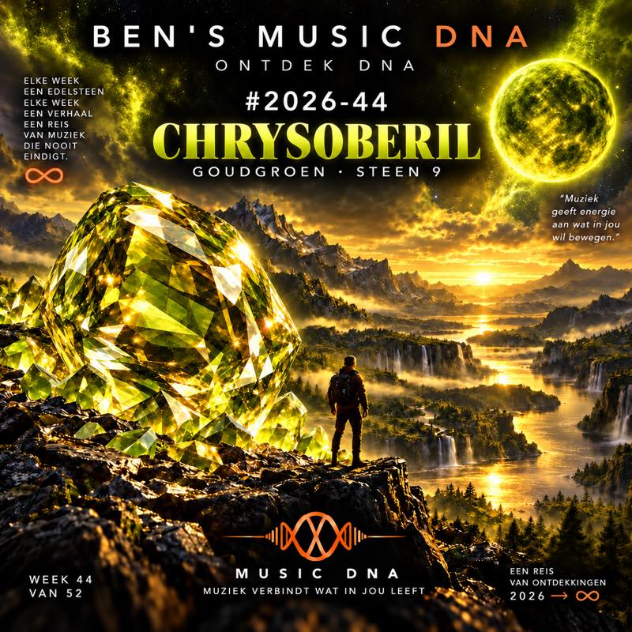

# Ontdek DNA W44 — selectie en publicatiepakket

**Doeldatum: zaterdag 31 oktober 2026 · gecontroleerd op 29 oktober 2026.**

**Muziekselectie vastgelegd: 21 nummers, 10 RAAK + 11 GOED, 1 uur 27 minuten 57 seconden. Hoes: CHRYSOBERIL · W44 · STEEN 9, v4 aangehouden na Bens “Mooi!”. Spotify-publicatie: NIET UITGEVOERD.**

## Uitgangspunt en behoud

Werkbranch vanaf live `main` `e7351f0c501d32a27248cb708d71a0106ee6abaf` (merge PR #21). De drie v1.0-registers zijn volledig gelezen; de gedateerde correcties van 25–29 oktober gaan vóór hun historische statusvragen. B05/B06/B07 blijven leidend: weekmodel gescheiden van oude dagpoorten, trackset vóór sequencing, echte beoordelingen en opslag beschermen. Geen nieuwe gebruikersregel afgeleid uit een voorstel.

Het [oorspronkelijke bronregister](../W44-SOURCE-REGISTER-2026-10-25.md) blijft bytegelijk, met alle 36 beoordelingen: 10 RAAK, 13 GOED, 7 TERUGKOMEN, 6 NIET. `selection.json` bevat een afgeleide kopie met bronposities; deze is geen nieuwe beoordelingsbron en wordt niet door de runtime geladen.

## Definitieve redactionele set en luistervolgorde

Deze opdracht autoriseert de keuze van 21. De set hieronder staat vast binnen dit voorbereidingspakket; een latere wissel vereist een nieuwe expliciete revisie van set, volgorde en controles. De volgorde is een redactionele muzikale boog op basis van brononderzoek en echte speelduur. De twintig overgangen zijn niet auditief beluisterd; geen BPM-, toonsoort- of perfecte-flowclaim.

| # | Artiest — nummer | Oordeel | Duur | Spotify |
| --- | --- | --- | --- | --- |
| 1 | Night Laser — Bittersweet Dreams | RAAK | 3:27 | [opname](https://open.spotify.com/track/4OEjJbIBMzaTFsYJhBF4DO) |
| 2 | Starmen — Ready to Give Me Your Love | RAAK | 4:08 | [opname](https://open.spotify.com/track/3pUuCPjhocrhbfQ8V0qO1G) |
| 3 | Mayank — Destiny Calling | GOED | 3:05 | [opname](https://open.spotify.com/track/7s3iIgurAG0xgDg1ebAweA) |
| 4 | Nitrate — All the Right Moves | RAAK | 3:54 | [opname](https://open.spotify.com/track/5R8u2wIpO2OKg2EhSygZne) |
| 5 | Vypera — Standing on the Edge | GOED | 3:56 | [opname](https://open.spotify.com/track/6Ko5PM4RK7eumjqnKt5Ahi) |
| 6 | Fans of the Dark — Life Kills | RAAK | 5:14 | [opname](https://open.spotify.com/track/45yGG3vEZTV8MBVxKqXAq5) |
| 7 | Junkyard Drive — Sweet Little Dreamer | GOED | 4:42 | [opname](https://open.spotify.com/track/6jIWMzMQ9NuGHAdPFxAjcI) |
| 8 | Smoking Snakes — Angels Calling | RAAK | 3:18 | [opname](https://open.spotify.com/track/5aISIm0BHmorW4Z7hMDdg7) |
| 9 | Trench Dogs — Homesick Parade | RAAK | 2:56 | [opname](https://open.spotify.com/track/6VnK5Xeg2u7Zg5qJqKYaDo) |
| 10 | MIDAS — Nobody Gets Out Alive | RAAK | 4:46 | [opname](https://open.spotify.com/track/6lmrfYBEaTpKk3M30yUrZ7) |
| 11 | Sanhedrin — Lost at Sea | RAAK | 4:28 | [opname](https://open.spotify.com/track/6Ny1GkA2KbnytfBYyQskzd) |
| 12 | Crypt Sermon — Heavy Is the Crown of Bone | GOED | 5:09 | [opname](https://open.spotify.com/track/2h7J8G3II0eZj0Kl8uDWmH) |
| 13 | Ashbury — The Warning | GOED | 3:59 | [opname](https://open.spotify.com/track/6jEGUmbMdvWq6Di1Kv61J0) |
| 14 | Lykantropi — Wild Flowers | GOED | 4:12 | [opname](https://open.spotify.com/track/3E6xrYViwCil3oK4pkqpZ4) |
| 15 | Magic Pie — Trick of the Trade | RAAK | 6:09 | [opname](https://open.spotify.com/track/6eKjzKEAz48JsIjsHTkGHH) |
| 16 | Artificial Language — Unself Portrait | GOED | 3:50 | [opname](https://open.spotify.com/track/58C4uAvr4MTr88Chmkc6nz) |
| 17 | Four Stroke Baron — Planet Silver Screen | GOED | 3:50 | [opname](https://open.spotify.com/track/0Ws0ZUpn49O9B1P4lVNvPx) |
| 18 | Grave Pleasures — Be My Hiroshima | RAAK | 3:46 | [opname](https://open.spotify.com/track/69feEDlBjijnisHbOWgH7P) |
| 19 | LeBrock — Runaway | GOED | 3:53 | [opname](https://open.spotify.com/track/3lS99gJJAWuxKxQfXArvvx) |
| 20 | Kalax — Out of Time | GOED | 4:55 | [opname](https://open.spotify.com/track/4O6pSwn4xxx8FdBBdqeEin) |
| 21 | Droid Bishop — Dancing in the Darkness | GOED | 4:21 | [opname](https://open.spotify.com/track/6Hy7t4RIksivCxEXyu6T1b) |

De opening bouwt een samenhangende melodieuze hardrockreeks: Night Laser en Starmen zetten de toon, Mayank geeft een korter melodieus rustpunt, Nitrate en Vypera brengen de vaart terug. Fans of the Dark en Junkyard Drive verbreden de nummers voordat Smoking Snakes en het korte Homesick Parade de rauwere straatrockkant opzoeken. MIDAS, Sanhedrin en Crypt Sermon maken het middendeel zwaarder. Ashbury en Lykantropi geven vervolgens ruimte en een warmere kleur. Magic Pie, Artificial Language en Four Stroke Baron voeren van melodieuze prog naar een modernere ritmische klank. Grave Pleasures opent de donkere laatste bocht; LeBrock verbindt rockzang met synths, Kalax en Droid Bishop sluiten de elektronische boog.

## Twee overblijvers — behouden, geen afboeking

- **Psychlona — Blast Off (GOED, 7:29):** exact geïdentificeerd op Venus Skytrip. Bewaard buiten deze 21 om de zware/progressieve middenboog compacter te houden. Dit is een keuze voor deze aflevering, geen lager smaakoordeel.
- **Barock Project — Broken (GOED, 9:06):** beschikbare Spotify-opname staat op DETACHMENT (2021 Remastered Version). De oorspronkelijke beoordeelde editie is niet bewezen. De lange speelduur en dat versieverschil maken afzonderlijk bewaren verantwoord.

Beide blijven positieve overblijvers in dit dossier. Er is geen operationele reserve-, wachtkamer-, FIFO- of gebruikstransactie uitgevoerd. Ook de zeven TERUGKOMEN en zes NIET blijven ongewijzigde bronbeoordelingen.

## Exacte opnamen en versiegrenzen

Alle 23 titels zijn in het ingelogde Spotify-account teruggevonden; 42 catalogus-ID’s, inclusief alternatieve uitgaven, zijn daarnaast via openbare Spotify-trackmetadata en embedgegevens gecontroleerd. Voor iedere kandidaat zijn titel, uitvoerders, concrete track-ID, uitgaveomschrijving, datum en duur vastgelegd. De 21 gekozen catalogus-ID’s zijn openbaar als PLAYABLE gemeld en vermelden Nederland in de toegestane landen. Dit is geen bewijs dat alle 21 volledig in het account zijn afgespeeld.

- Mayank: de albumopname uit Mayank, inclusief Gui Oliver als uitvoerderscredit; de single heeft een ander ID.
- Smoking Snakes: het oude spoor `4OwMV6IYkRlohw3iv7gCKg` is de single Angels Calling, niet het album Danger Zone. De gekozen track staat op Danger Zone.
- Magic Pie: oud ID `7dMRPEtSa7GBMJ5Y1OTDWZ` blijft als bronspoor bestaan. Het huidige accountzoekresultaat geeft `6eKjzKEAz48JsIjsHTkGHH`; dat ID vermeldt Nederlandse toelating. Titel, artiest, King for a Day, releasedatum, duur 368586 ms en preview-URL komen overeen. Geen volledige ISRC-/audiofingerprintgelijkheid geclaimd.
- Vypera: de reguliere Standing on the Edge op Eat Your Heart Out (Bonus Track Edition), niet de piano-bonustrack.
- LeBrock en Kalax: de gezongen catalogusversies, niet hun afzonderlijke instrumentalversies; Kalax heeft ook PYXIS en Jay Diggs in de uitvoerderscredits.
- Droid Bishop: de albumuitgave Into The Abstract gekozen; single-ID afzonderlijk bewaard. Barock: remaster expliciet gemarkeerd, niet stilzwijgend als oorspronkelijke opname behandeld.

De oorspronkelijke beoordelingsbron bevat geen track-ID’s. De huidige identificatie koppelt daarom de bedoelde titel/uitgave aan een controleerbare catalogusopname; zij bewijst niet achteraf welk Spotify-ID bij de oorspronkelijke luisterbeurt actief was.

## Herhalingscontrole

W42 en W43 zijn op 29 oktober rechtstreeks van Spotify teruggelezen. Beide lijsten hebben 21 tracks en komen op alle IDs en in volgorde overeen met respectievelijk het bestaande W42-use-record en het W43-observatierecord. W43 is daarmee nu onafhankelijk qua huidige inhoud bevestigd. De oorspronkelijke records zijn niet gewijzigd; actuele readback bewijst geen oorspronkelijke publicatietijd.

Geen van de 23 primaire artiesten of expliciet gecontroleerde naamvarianten/aliassen komt voor in deze 42 tracks. Geen van de 42 gecontroleerde W44-catalogusvariant-ID’s overlapt met W42/W43. De volledige Spotify-uitvoerderscredits van die weken zijn meegenomen, inclusief gastmuzikanten. De afgeleide vergelijking staat in `history-comparison.json`.

Verder zijn 1452 beschikbare bronbestanden heropend en gehasht, waaronder huidige repositorydata, Master/Depot, oudere week-/kandidaatbronnen, archieftekst, werkboeken en gedecodeerde surprise-bronnen; 0 ontbrekende paden. Geen naam-/aliastreffer voor deze 23. Veel bronnen zijn kopieën of kandidaten, geen onafhankelijke publicatiebewijzen. De Master/Depot-bron is versie 1.14.4 met 3.877 records; onbekende recentere apparaatdata worden niet gereconstrueerd.

Bewijsgrens blijft: volledige privécollectie, niet geëxporteerde telefoonhistorie, alle mogelijke aliassen, ISRC- en volledige audiofingerprintvergelijking zijn niet gedekt. De uitkomst is een geslaagde controle tegen beschikbare bewezen en overige beschikbare historie, geen universele onbekendheidsclaim. Oudere documenten blijven historische bronnen en worden niet als nieuwe levering geboekt.

## Edelsteen, hoes en beschrijving

**W44-steentoewijzing: CHRYSOBERIL, steen 9.** De eerdere smaragdproeven zijn verworpen: eerst botsten groen en geel, daarna werd het beeld te koel en week de sfeer af van de eerste acht hoezen. Ben bevestigde dat de kleurkeuze uit die bestaande reeks moet volgen. De vierde proef is direct vanuit W43 gemaakt, met behoud van de warme lichtende sfeer en een kleine goudgroene verschuiving. Ben reageerde daarop “Mooi!”. V4 wordt aangehouden; geen vijfde afbeelding gemaakt. Zie [kleurkeuze, beoordeling en bronnen](GEMSTONE-2026-44.md).

De vaste beeldfamilie blijft die van W39/W40: filmisch berglandschap, monumentale steen links, kleine reiziger, lichtende hemelbol, vaste Ben’s Music DNA/ONTDEK DNA-kop, week/steen en DNA-footer. Een W44-bestand moet hiermee visueel worden vergeleken en op tekst/steen/teller worden gecontroleerd. Bestaande visuele tests alleen zijn onvoldoende: de gedocumenteerde tellercontrole accepteerde eerder onjuiste waarden.

De kant-en-klare beschrijving staat in `spotify-description.txt`, met een korte muziekinleiding en de zakelijke chrysoberilalinea. Mineralogische feiten zijn gecontroleerd bij GIA en de International Colored Gemstone Association; de bronnen staan afzonderlijk in GEMSTONE-2026-44.md. Geen symbolische eigenschappen of technische procesinformatie in de playlisttekst.

## Klaar voor uitvoering na visuele hoescontrole

1. Hercontroleer live main, deze pakketversie en eventuele bestaande W44-playlist om dubbele aanmaak te voorkomen. Controleer eigenaar Ben van Belzen (`11124659869`).
2. Maak eerst een besloten W44-werkplaylist. Gebruik uitsluitend de 21 URI’s in `spotify-uris.txt`, in die volgorde; `spotify-import.csv` is de leesbare controlelijst. Voeg geen zeven nieuwe kandidaten toe zonder hun eigen gecontroleerde bronset.
3. Lees de nieuwe playlist geheel terug: 21 tracks, exacte geordende IDs, uitvoerders, duur en eventuele relinking. Controleer afspeelbaarheid in het account. Bij afwijking stoppen en oorzaak vastleggen; geen identiteiten raden.
4. Beluister de twintig overgangen als afzonderlijke Flow-controle, vooral Crypt Sermon→Ashbury en Four Stroke Baron→Grave Pleasures. Verander uitsluitend volgorde binnen dezelfde set; registreer iedere revisie en herhaal readback.
5. Plaats pas de bewezen goedgekeurde W44-hoes en de definitieve beschrijving. Controleer naam, afbeelding, volledige tekst, eigenaar, zichtbaarheid en aantal opnieuw na herladen.
6. Publiceer alleen bij volledige controle, passend bij zaterdag 31 oktober. Leg playlist-ID, geordende tracklijst, tijdzone/tijdstip, omschrijving, hoesvingerafdruk en verificatiemethode vast in een nieuw ontvangstbewijs. Publicatie is geen FIFO- of ratingsimport.

Er is nu geen W44-playlist aangemaakt, gewijzigd of gepubliceerd. De accounttoegang is wel aangetoond; volledige geauthenticeerde readback van de nog te maken doelplaylist blijft een uitvoeringsstap. Er is geen taak ingepland en geen werkende automatische zaterdagproductie geclaimd.

## Bestanden en validatie

- `selection.json`: alle 36 bronbeoordelingen als kopie, 23 kandidaatidentiteiten, 21 volgordeposities en twee overblijvers; uitsluitend redactioneel.
- `spotify-catalogue-evidence.json`: openbare catalogusmetadata, geen sessietokens.
- `spotify-history-readback.json` en `history-comparison.json`: onafhankelijke actuele W42/W43-inhoud en vergelijking.
- `no-repeat-source-summary.json`: bronhashes, scope en begrensde uitkomst van de bredere scan.
- `spotify-import.csv`, `spotify-uris.txt`, `spotify-description.txt`: concrete publicatievoorbereiding.
- `validation.json`: behoud, tellingen, selectie, beschikbare historie en uitgevoerde lokale controles.

Geen productiecode of operationele data gewijzigd. Current/original/legacy, FIFO, reserves, journalen en afzonderlijke Walk & Listen-opslag blijven onaangeroerd. PR #18 blijft conflicterend en wordt niet meegenomen. Deze W44-branch wordt niet automatisch gemerged.

## Gekozen hoesbestand

V4 is aangehouden na Bens reactie “Mooi!”. Direct gemaakt vanuit de bestaande W43-hoes met ingebouwde imagegen; prompt in cover-prompt-v4.txt. Oudere proeven blijven als ontwerphistorie bewaard. Deze beeldkeuze verandert geen Spotify-playlist of muziekselectie.
